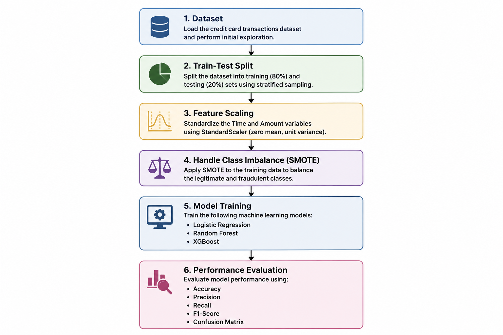
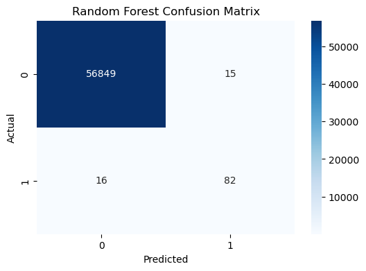
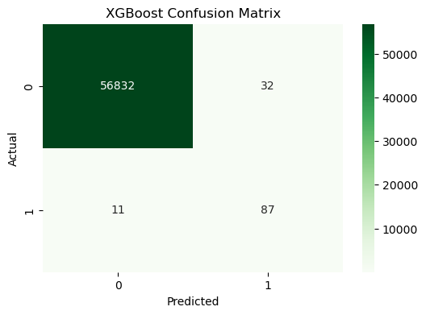

# Credit Card Fraud Detection — Machine Learning Comparison

Bachelor's thesis project examining highly imbalanced credit card transaction classification with **Logistic Regression, Random Forest, and XGBoost**.

## Overview

The objective is to identify fraudulent transactions while considering the trade-off between missed fraud and false alarms. The analysis uses the **Credit Card Fraud Detection** dataset published by the Machine Learning Group at ULB (available on [Kaggle](https://www.kaggle.com/datasets/mlg-ulb/creditcardfraud)). The dataset contains **284,807 transactions, including 492 fraudulent transactions**. The original feature names `V1`–`V28` are anonymized PCA components; `Time` and `Amount` are additional features.

## Thesis results

The following values are **reported in the original bachelor's thesis**. They are not claimed as freshly rerun benchmarks.

| Model | Accuracy | Precision (fraud) | Recall (fraud) | F1 (fraud) |
|---|---:|---:|---:|---:|
| Logistic Regression | 0.9742 | 0.0580 | 0.9184 | 0.1092 |
| Random Forest | 0.9995 | 0.8454 | 0.8367 | **0.8410** |
| XGBoost | 0.9992 | 0.7311 | **0.8878** | 0.8018 |

Random Forest achieved the best reported F1 score, while Logistic Regression had higher recall at the cost of numerous false positives. Accuracy alone is misleading on an extremely imbalanced dataset.

## Methodology

1. Stratified train/test split (80%/20%, `random_state=42`).
2. Fit `StandardScaler` on **training** `Time` and `Amount`; transform test with the same scaler.
3. Apply **SMOTE to training data only**, never to the held-out test set.
4. Train Logistic Regression, Random Forest, and XGBoost on the balanced training set.
5. Evaluate on the original imbalanced held-out test set using accuracy, precision, recall, F1, confusion matrices, ROC-AUC and PR-AUC.

The `src/train.py` script provides a clean reproducible version of this procedure and **adds PR-AUC reporting**. Its numbers may differ slightly from the archived thesis depending on package versions and runtime environment. The original academic notebook remains in `notebooks/Bachelorarbeit_original.ipynb` for reference.

## Repository structure

```text
Credit-Fraud-ML/
├── src/train.py                     # Reproducible training and evaluation
├── notebooks/Bachelorarbeit_original.ipynb
├── assets/                          # Original thesis figures
├── tests/test_preprocessing.py
├── requirements.txt
├── .gitignore
└── README.md
```

## Installation & execution

Python 3.11 or 3.12 recommended. From the project root:

```powershell
python -m venv .venv
.\.venv\Scripts\Activate.ps1
python -m pip install -r requirements.txt
```

Download `creditcard.csv` from the [ULB / Kaggle dataset](https://www.kaggle.com/datasets/mlg-ulb/creditcardfraud) and save it as `data/creditcard.csv` (create the `data` directory first). The dataset is deliberately **not redistributed** here.

```powershell
python -m pytest -q
python -m src.train --data data/creditcard.csv --output results
```

Results are saved as `results/model_comparison.csv`, `results/metrics.json`, and confusion-matrix PNGs. Training on the full SMOTE-balanced dataset can be time-consuming and memory intensive.

## Example figures







## Scope & limitations

- This is an **academic research and portfolio project**, not a production financial fraud-detection system.
- The published dataset is historical, anonymized, and not representative of a bank's modern production transaction stream.
- A stratified random split follows the thesis methodology; temporal validation would be a valuable next step.
- SMOTE can create synthetic minority-class training examples, which are **not** real additional fraud transactions.
- Real deployments require calibration, threshold selection, drift monitoring, operational risk assessment, and security controls.
- No real private customer data or model credentials are published.
